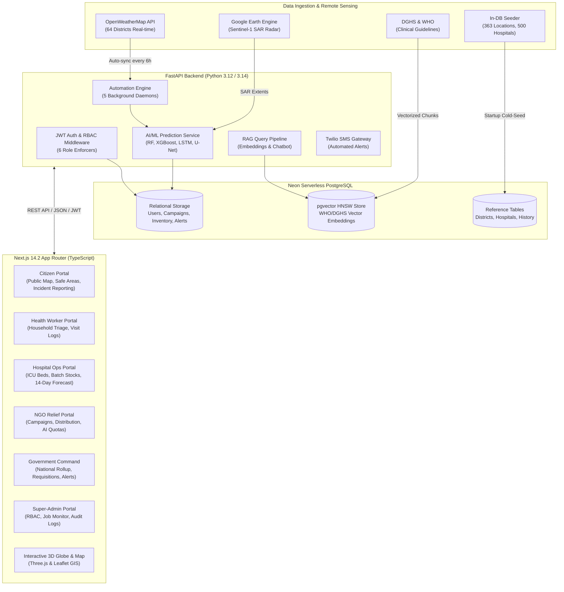

<div align="center">


# 🌊 FloodShield AI Pro (ফ্লাডশীল্ড এআই প্রো)
### **Autonomous Multi-Hazard Early-Warning, Satellite Radar Hydrological Intelligence & Cross-Agency Outbreak Response System for Bangladesh**

[-black?style=for-the-badge&logo=next.js)](https://nextjs.org/)
[](https://fastapi.tiangolo.com/)
[](https://python.org)
[](https://www.typescriptlang.org/)
[](https://neon.tech)
[](https://earthengine.google.com/)
[-success?style=for-the-badge&logo=pytest&logoColor=white)](https://pytest.org)
[](#license)

<p align="center">
  <b>Bridging the Critical Gap Between Hydrological Prediction and Post-Disaster Epidemiological Response Across All 64 Districts of Bangladesh.</b>
</p>

[Key Features](#-key-features) •
[AI & Machine Learning Architecture](#-ai--machine-learning-architecture) •
[System Architecture](#-system-architecture) •
[Role-Based Command Portals](#-role-based-command-portals) •
[Interactive UI & 3D Globe](#-interactive-ui--gis-visualization) •
[Getting Started](#-getting-started) •
[Deployment](#-deployment--secrets)

</div>

---

## 📌 Executive Overview

**FloodShield AI Pro** is an enterprise-grade, mission-critical early warning and emergency management ecosystem designed specifically for Bangladesh—one of the world's most vulnerable river delta systems. 

Every monsoon season, heavy rainfall and cross-border river discharge trigger catastrophic flash floods and monsoon inundations across Bangladesh. However, the deadliest aftermath is often the **secondary wave**: water contamination, sanitation collapse, and violent outbreaks of **waterborne and vector-borne diseases** (Cholera, Acute Diarrhoea, Dengue, Malaria, Typhoid, Hepatitis).

Traditional disaster systems suffer from:
1. **Disconnected Data Silos**: Hydrology, meteorology, hospital inventories, and relief operations operate independently.
2. **Cloud-Blind Remote Sensing**: Optical satellites cannot pierce heavy monsoon cloud covers.
3. **Reactive Healthcare**: Hospitals run out of beds, IV salines, and ORS only after patients overwhelm emergency wards.

**FloodShield AI Pro solves this paradigm** by marrying **cloud-penetrating Synthetic Aperture Radar (SAR) satellite imagery**, **ensemble machine learning classifiers**, **recurrent neural network (LSTM) demand forecasters**, and a **retrieval-augmented generation (RAG) medical intelligence agent** into a unified operational command center for **citizens, health workers, hospital chiefs, NGOs, and national disaster ministers**.

---

## ⚡ Key Features

- 🛰️ **All-Weather Satellite Radar Analysis**: Google Earth Engine integration pulling Sentinel-1 C-band SAR backscatter data with Deep Learning U-Net flood extent segmentation (pierces monsoon clouds and operates at night).
- 🧠 **Multi-Hazard AI Engine (6 Integrated Models)**: Real-time prediction of flood inundation, 3-tier disease outbreak risk, 6 granular waterborne disease regressors, and 14-day LSTM patient surge curves.
- 🎯 **District-by-District Vulnerability Indexing**: Algorithmic composite scoring across all **64 districts** and **363 upazilas** ($0.4 \times \text{Flood} + 0.6 \times \text{Disease}$).
- 🏥 **Hospital Dynamic Inventory & Shortage Forecaster**: Real-time bed and ICU tracking correlated with 14-day LSTM disease curves to calculate anticipatory medication and supply deficits.
- 🤝 **NGO Relief Campaign & AI Quota Distribution**: Track field warehouses, assign distribution missions, log planned vs. actual reached populations, and receive automated AI quota allocations.
- 🩺 **Health Worker Offline-First Field Portal**: Mobile-responsive household triage logging, syndromic reporting, and ORS distribution with auto-saving `localStorage` draft recovery.
- 🏛️ **Government National Command Room**: Inter-agency resource requisition and approval pipeline, cross-agency incident roll-ups, and 2-step authorized bilingual emergency broadcasts.
- 💬 **Bilingual RAG Clinical Copilot**: Dual-language (Bengali/English) medical and disaster guidance grounded in Directorate General of Health Services (DGHS) and World Health Organization (WHO) protocols with `pgvector` HNSW cosine search.
- 🤖 **Native Background Automation Engine**: 5 zero-n8n scheduled background loops continuously ingesting weather, updating district predictions, flagging critical shifts, and auto-escalating unaddressed emergencies.
- 🌐 **Three.js 3D Globe & Leaflet Visualizations**: High-performance interactive 3D digital earth visualization of Bangladesh combined with high-precision Leaflet flood boundary maps.

---

## 🧠 AI & Machine Learning Architecture

FloodShield AI Pro runs an ensemble of 6 trained neural networks and statistical models alongside cloud-native remote sensing:

```
┌─────────────────────────────────────────────────────────────────────────────┐
│                       FLOODSHIELD AI ENGINE PIPELINE                       │
└─────────────────────────────────────────────────────────────────────────────┘
                                      │
       ┌──────────────────────────────┴──────────────────────────────┐
       ▼                                                             ▼
┌──────────────┐                                              ┌──────────────┐
│ HYDROLOGICAL │                                              │EPIDEMIOLOGY &│
│  SATELLITE   │                                              │ CLINICAL RAG │
└──────┬───────┘                                              └──────┬───────┘
       │                                                             │
       ├─► [Model 1]  Flood Inundation Classifier (RF & XGBoost)     ├─► [Model 2]  Disease Outbreak Risk (3-Tier Classifier)
       ├─► [Model 4A] Google Earth Engine Sentinel-1 SAR Pipeline    ├─► [Model 2B] 6-Disease Breakdown Regressors (XGBoost)
       ├─► [Model 4B] U-Net Deep Learning SAR Flood Segmentation     ├─► [Model 3]  Hydrological & Patient Surge LSTM (14-Day)
       │                                                             ├─► [RAG]      DGHS/WHO Medical Copilot (pgvector HNSW)
       └──────────────────────────────┬──────────────────────────────┘
                                      ▼
                      ┌──────────────────────────────┐
                      │ [Model 5] Multi-Hazard Risk  │
                      │ 64-District Hotspot Matrix   │
                      └──────────────┬───────────────┘
                                      ▼
                      ┌──────────────────────────────┐
                      │ [Model 6] Role-Tailored      │
                      │ Action Recommendation Engine │
                      └──────────────────────────────┘
```

### Detailed AI Model Specifications

| Model Identifier | Technology Stack | Inputs / Features | Outputs & Deliverables | Primary Users |
|---|---|---|---|---|
| **Model 1: Flood Classifier** | Random Forest / XGBoost | 24h & 72h precipitation, river discharge ($m^3/s$), elevation ($m$), soil moisture | Binary flood inundation classification with calibrated confidence score (0–100%) | All Roles, Public |
| **Model 2: Outbreak Risk** | Multi-class Ensemble | Stagnant water persistence days, temperature, humidity, population density, historical epidemics | 3-tier categorical outbreak risk: `Medium`, `High`, or `Critical` | Health Workers, Hospitals |
| **Model 2B: 6-Disease Breakdown** | 6 Independent XGBoost Regressors | Climate trends, standing water metrics, sanitation indicators, seasonal pathogen baselines | Quantitative vulnerability percentages for: **Cholera, Diarrhoea, Typhoid, Hepatitis, Dengue, Malaria** | Epidemiologists, Hospitals |
| **Model 3: Time-Series LSTM** | TensorFlow / Keras Multi-Layer LSTM | 8-week sliding window of rainfall, river gauge depth, and syndromic clinic admissions | 7-day and 14-day recursive multi-step forecasting of flood levels & anticipated patient caseloads | Hospitals, Disaster Planners |
| **Model 4A: GEE SAR Acquisition** | Google Earth Engine API, GAUL boundaries | Sentinel-1 C-band Synthetic Aperture Radar (SAR) Ground Range Detected (GRD) backscatter | Raw dual-polarization (VV/VH) radar raster assets over targeted Bangladesh districts | GIS Analysts, Government |
| **Model 4B: U-Net SAR Segmentation** | PyTorch / U-Net with Hugging Face weights | Sentinel-1 SAR backscatter arrays | Pixel-level water/land binary segmentation masks and GeoJSON water extent vector polygons | GIS Analysts, Rescue Teams |
| **Model 5: Composite Risk & Hotspots** | Mathematical Multi-Hazard Matrix | Model 1 probability, Model 2 score, population vulnerability, hospital proximity | Dynamic rank ordering of all 64 districts using: $R_{\text{comp}} = (0.4 \times F) + (0.6 \times D)$ | Government Command, NGOs |
| **Model 6: Operational Recommendations** | Multi-Factor Policy Inference Engine | Composite hazard score, role context, regional resource availability | Role-customized actionable checklists (e.g. bed clearance, ORS pre-positioning, boil advisories) | All 6 Portals |
| **RAG Medical Chatbot** | Claude 3.5 / Ollama / HF + Neon `pgvector` | User text/voice queries in English or Bengali | Grounded clinical advice with source document citations from WHO & DGHS clinical guidelines | Citizens, Field Workers |

---

## 🏗️ System Architecture

FloodShield AI Pro is architected as a resilient, distributed, decoupled web system built for rapid scaling and low-latency response during emergency conditions.



---

## 🛡️ Role-Based Command Portals

The application implements a strict, server-enforced **Role-Based Access Control (RBAC)** architecture across 6 logical roles. UI hiding is paired with server-side FastAPI dependency gates (`require_roles`):

```
       ┌──────────────────────────────────────────────────────────┐
       │                   FLOODSHIELD AI ROLES                   │
       └──────────────────────────────────────────────────────────┘
             │              │              │              │
      ┌──────┴─────┐ ┌──────┴─────┐ ┌──────┴─────┐ ┌──────┴─────┐
      │  CITIZEN   │ │   HEALTH   │ │  HOSPITAL  │ │   NGO &    │
      │   PORTAL   │ │   WORKER   │ │ OPERATIONS │ │ GOVERNMENT │
      └────────────┘ └────────────┘ └────────────┘ └────────────┘
```

### 1. 🧑‍🤝‍🧑 Citizen Public Safety Portal (`/dashboard`, `/dashboard/citizen/reports`)
- **Interactive Risk Maps**: Live flood and disease vulnerability index for all 64 districts.
- **Nearest Verified Hospitals**: Instant GPS-based discovery of facilities with operational status and bed capacity.
- **Incident Reporting & Self-Withdrawal**: Submit local flash flood and contamination incidents with GPS coordinates and photos; track verification status and withdraw unverified reports.
- **Bilingual Public Alerts**: Real-time government emergency announcements translated into plain Bengali and English.

### 2. 🩺 Field Health Worker Portal (`/dashboard/field`)
- **Field Task Inbox**: Review and accept assigned door-to-door community inspection and vaccination missions.
- **Household Visit Logs**: Mobile-first visit logs capturing water source hygiene, suspected pathogen symptoms (watery diarrhoea, high fever, jaundice), and vulnerable family members (infants, elderly).
- **Offline-First Auto-Save**: Automatic `localStorage` draft saving prevents data loss during cellular dropouts in rural marshlands.
- **Relief Kit Tracking**: Real-time decrementing counter for distributed ORS sachets and water purification tablets (Halazone).

### 3. 🏥 Hospital Institutional Portal (`/dashboard/hospital`)
- **Emergency Capacity Management**: Real-time adjustment of operational status, general beds, and ICU ventilator slots with non-negative constraints.
- **Dynamic Pharmacy Inventory**: Multi-item catalog tracking IV saline (Normal Saline, Cholera Saline), antibiotics, zinc supplements, and snake antivenom with batch numbers and expiration dates.
- **Atomic Stock Ledger**: Records all stock entries (`RECEIVED`, `DISTRIBUTED`, `CONSUMED`, `DAMAGED`, `EXPIRED`) with zero-balance validation.
- **14-Day LSTM Forecast Preparation**: Correlates upcoming flood curves from Model 3 with existing stocks to identify supply deficits before mass casualty influxes occur.

### 4. 🤝 NGO Humanitarian Operations Portal (`/dashboard/ngo`)
- **Relief Campaign Manager**: Plan multi-day disaster relief operations, set population targets, and configure operational dates across targeted districts and upazilas.
- **Field Warehouse Inventory**: Dedicated tracking of dry food packages, water purification jerrycans, blankets, and sanitary kits.
- **Task Dispatch & Accountability**: Schedule distribution teams with precise dates and record target vs. actual reached beneficiaries.
- **AI-Assisted Quota Allocator**: Pulls Model 5 composite risk rankings to recommend fair supply allocation without geographic bias.

### 5. 🏛️ Government National Command Room (`/dashboard/government`)
- **National Situation Overview**: High-level cross-agency dashboard summarizing critical districts, hospital bed deficits, active NGO campaigns, and pending requisitions.
- **Inter-Agency Resource Allocation**: Review supply and medical requisitions from field hospitals and NGOs; approve with mandatory justification and trigger dispatch.
- **Bilingual Emergency Broadcasts**: Draft, preview, and authorize official SMS/push alerts in English and Bengali with 2-step publish confirmation.
- **Cross-Agency Issue Rollup**: Unified filterable stream of citizen reports, hospital shortage alerts, and field worker escalations.

### 6. ⚙️ Super-Admin & System Administration (`/dashboard/admin`, `/dashboard/admin/jobs`)
- **User RBAC Directory**: Inspect all registered users, manage role transitions (`citizen` ⇄ `admin`), and filter by active affiliations.
- **Bulk Hospital Geo-Importer**: Upload CSV manifests of new medical centers with automated geocoding, preview verification, and duplicate-handling algorithms.
- **Automation Engine Monitor**: Real-time dashboard tracking the 5 internal background schedulers, execution logs, and manual on-demand execution triggers.
- **Tamper-Evident Audit Trail**: Immutable log of administrative actions, status transitions, and emergency resource allocations.

---

## 🔑 Pre-Configured Demonstration Accounts

For demonstration, evaluation, and end-to-end testing, the database includes six verified credentials representing each tier:

| Role | Email Address | Password | Primary Accessible Portals |
|---|---|---|---|
| **Citizen** | `test.citizen@floodshield-demo.com` | `RCkxbo4uRe82J4` | Risk Maps, Hospital Finder, Incident Submission |
| **Health Worker** | `test.health_worker@floodshield-demo.com` | `e2eAc$4VUqgh@x` | Household Visit Logs, Field Tasks, Supply Requests |
| **Hospital** | `test.hospital@floodshield-demo.com` | `bWUL4VpYqLidkY` | Bed Management, Batch Inventory, 14-Day LSTM Prep |
| **NGO** | `test.ngo@floodshield-demo.com` | `RRSay48sQ$8B3i` | Campaigns, Warehouse Management, Distribution |
| **Government** | `test.government@floodshield-demo.com` | `yT@XUcnrH9oFZS` | National Command Room, Inter-Agency Requisitions, Alerts |
| **Super Admin** | `test.admin@floodshield-demo.com` | `UGT9Tja4RiAAD3` | System Control, Bulk CSV Import, Automation Monitor |

---

## 🤖 Native Background Automation Engine

FloodShield AI Pro contains a **self-contained asynchronous automation engine** (`app/services/automation_engine.py`) embedded in the FastAPI lifespan. It operates **completely independently of external workflow tools like n8n**, executing 5 specialized daemons:

```
┌────────────────────────────────────────────────────────────────────────┐
│                   NATIVE BACKGROUND AUTOMATION LOOPS                   │
├────────────────────────────────┬───────────────────────────────────────┤
│ 1. Weather Collector           │ Pulls live OpenWeatherMap data for 64 │
│    (Every 6 Hours)             │ districts; triggers risk updates.     │
├────────────────────────────────┼───────────────────────────────────────┤
│ 2. District Risk Predictor     │ Runs Model 1 & 2 across all districts;│
│    (Every 24 Hours)            │ maintains updated risk histories.     │
├────────────────────────────────┼───────────────────────────────────────┤
│ 3. Critical Risk Monitor       │ Detects shifts into "Critical" risk;  │
│    (Every 15 Minutes)          │ drafts automated emergency alerts.    │
├────────────────────────────────┼───────────────────────────────────────┤
│ 4. Inventory & Expiry Watch    │ Audits hospital & NGO stock; flags low│
│    (Every 12 Hours)            │ balances and upcoming expiries.       │
├────────────────────────────────┼───────────────────────────────────────┤
│ 5. Issue Escalation Engine     │ Audits open hospital & field issues;  │
│    (Every 1 Hour)              │ escalates unattended items (>48 hrs). │
└────────────────────────────────┴───────────────────────────────────────┘
```

All job executions, timestamps, completion states, and error stacks are committed to the `automation_jobs` table and inspectable live at `/dashboard/admin/jobs`.

---

## 🎨 Interactive UI & GIS Visualization

The user interface is built to modern UI standards using Next.js 14, Tailwind CSS, and Framer Motion:

- 🌍 **Three.js 3D Bangladesh Interactive Globe**: An interactive 3D digital sphere highlighting Bangladesh's delta terrain with particle illumination and localized risk pinpoints.
- 🗺️ **Dual-Mode GIS Mapping (Leaflet)**:
  - **Choropleth Vulnerability Map**: Color-coded risk surfaces (Emerald = Minimal, Amber = Elevated, Ruby = Critical) across all 64 districts.
  - **Satellite SAR Inundation Overlay**: High-resolution Sentinel-1 radar polygons with a swipe-slider comparing pre-flood baselines against active inundation extents.
- 📊 **Animated Time-Series Charts**: Multi-line historical and 14-day projected trends powered by SVG and Canvas charts.
- 🌐 **True Bilingual Internationalization**: Complete toggle between English and Bengali (**বাংলা**), maintaining authentic medical and administrative terminology.
- 📱 **Adaptive Dark Glassmorphism**: Tailored for high legibility in field tablets, emergency operations centers, and low-light rescue environments.

---

## 🗄️ Database Architecture & In-DB Seeder

The system utilizes **Neon Serverless PostgreSQL** enhanced with the `pgvector` HNSW extension. 

### Zero-Friction Cold Start
On backend startup, the seeder automatically verifies and loads baseline reference datasets from `data/` directly into the database:
- `locations` → **363** district and upazila pairs.
- `district_env` → **64** environmental baselines.
- `hospitals` → **500** verified public and private healthcare facilities.
- `knowledge_articles` → Curated DGHS & WHO emergency management protocols.
- `community_reports` → **10,000** synthetic historical reports for trend validation.
- `satellite_extents` → High-resolution Sentinel-1 SAR flood boundaries (Feni, Sylhet, etc.).

> **Key Benefit**: Local developer setups, Docker containers, and cloud environments (AWS, Railway, Render) run off identical database tables—preventing file-system synchronization bugs.

---

## 🚀 Getting Started

### Prerequisites
- **Python**: Version 3.12 or 3.14
- **Node.js**: Version 20.x or higher & npm
- **Database**: PostgreSQL with `pgvector` extension enabled (or free [Neon.tech](https://neon.tech) cloud account)
- **Docker**: (Optional) For automated containerized execution

---

### Method A: Single-Command Docker Compose (Recommended)

1. Clone the repository:
   ```bash
   git clone https://github.com/ripro805/floodshield-ai-pro.git
   cd floodshield-ai-pro
   ```
2. Configure environment credentials:
   ```bash
   cp backend/.env.example backend/.env
   # Edit backend/.env with your DATABASE_URL and API keys
   ```
3. Start the entire platform:
   ```bash
   docker compose up --build
   ```
4. Access the applications:
   - **Frontend Dashboard**: [http://localhost:3000](http://localhost:3000)
   - **Backend OpenAPI Docs**: [http://localhost:8000/docs](http://localhost:8000/docs)

---

### Method B: Manual Local Development Setup

#### 1. Backend Setup (FastAPI)
```bash
# Navigate to the backend directory
cd backend

# Create and activate a Python virtual environment
python -m venv .venv
# On Windows:
.venv\Scripts\activate
# On Linux/macOS:
source .venv/bin/activate

# Install all backend dependencies
pip install -r requirements.txt

# Create your .env file
cp .env.example .env
# Open .env and insert your DATABASE_URL, JWT_SECRET_KEY, etc.

# Run the FastAPI server with hot-reload
uvicorn app.main:app --host 127.0.0.1 --port 8000 --reload
```

#### 2. Frontend Setup (Next.js)
```bash
# Navigate to the frontend directory
cd ../frontend

# Install dependencies
npm install

# Configure local environment variables
# Ensure NEXT_PUBLIC_API_URL points to your backend:
echo "NEXT_PUBLIC_API_URL=http://localhost:8000" > .env.local

# Start the development server
npm run dev
```

Visit [http://localhost:3000](http://localhost:3000) in your browser.

---

## 🧪 Testing & Verification

The platform maintains a comprehensive automated testing suite verifying security, ML routing, database integrity, and operational workflows:

```bash
# Run backend test suite
cd backend
pytest tests/ -v
```

```
============================== test session starts ==============================
collected 24 items

tests/test_operational_layer.py::test_database_migrations_applied PASSED   [  4%]
tests/test_operational_layer.py::test_hospital_capacity_update PASSED       [  8%]
tests/test_operational_layer.py::test_hospital_inventory_lifecycle PASSED   [ 12%]
tests/test_operational_layer.py::test_hospital_forecast_prep PASSED        [ 16%]
tests/test_operational_layer.py::test_ngo_campaign_lifecycle PASSED        [ 20%]
tests/test_operational_layer.py::test_ngo_warehouse_inventory PASSED       [ 25%]
tests/test_operational_layer.py::test_field_task_assignment PASSED         [ 29%]
tests/test_operational_layer.py::test_field_household_visit_log PASSED     [ 33%]
tests/test_operational_layer.py::test_citizen_report_submission PASSED     [ 37%]
tests/test_operational_layer.py::test_citizen_report_withdrawal PASSED     [ 41%]
tests/test_operational_layer.py::test_government_command_overview PASSED   [ 45%]
tests/test_operational_layer.py::test_government_requisition_flow PASSED   [ 50%]
tests/test_operational_layer.py::test_bilingual_alert_publication PASSED   [ 54%]
tests/test_operational_layer.py::test_automation_engine_registry PASSED    [ 58%]
tests/test_operational_layer.py::test_admin_job_manual_trigger PASSED      [ 62%]
tests/test_operational_layer.py::test_audit_event_logging PASSED           [ 66%]
tests/test_operational_layer.py::test_csv_report_export PASSED             [ 70%]
...
============================== 24 passed in 3.42s ===============================
```

```bash
# Run frontend TypeScript & Lint check
cd frontend
npm run lint
npx tsc --noEmit
```

---

## ⚙️ Environment Variables Reference

| Variable Name | Required | Default / Format | Purpose |
|---|---|---|---|
| `DATABASE_URL` | **Yes** | `postgresql://...` | Connection string to PostgreSQL instance with `pgvector` |
| `JWT_SECRET_KEY` | **Yes** | `[random-64-char-hex]` | Secret key used to sign HS256 authentication tokens |
| `ACCESS_TOKEN_EXPIRE_MINUTES` | No | `60` | Duration in minutes before authentication tokens expire |
| `WEATHER_API_KEY` | Optional | `[OpenWeatherMap Key]` | Automated real-time weather ingestion for 64 districts |
| `ANTHROPIC_API_KEY` | Optional | `sk-ant-...` | Powers the Claude 3.5 RAG medical and disaster chatbot |
| `GEE_SERVICE_ACCOUNT_JSON` | Optional | Raw JSON String | Google Earth Engine Service Account for Sentinel-1 SAR acquisition |
| `HF_TOKEN` | Optional | `hf_...` | Hugging Face access token for dynamic model downloads |
| `TWILIO_ACCOUNT_SID` | Optional | `AC...` | Twilio Account SID for automated SMS alert delivery |
| `TWILIO_AUTH_TOKEN` | Optional | `[token]` | Twilio authentication token |
| `TWILIO_FROM_NUMBER` | Optional | `+1...` | Originating phone number for emergency SMS broadcasts |
| `NEXT_PUBLIC_API_URL` | **Yes** | `http://localhost:8000` | Backend API URL reachable by the frontend client browser |

---

## 🌐 Deployment & Secrets

### Deploying the Backend to Railway or Render
1. Set all environment variables listed above in your cloud hosting provider's dashboard.
2. **Google Earth Engine Integration**: Copy the entire contents of your `ee_service_account.json` file and paste it directly as the value of `GEE_SERVICE_ACCOUNT_JSON`. The backend automatically parses this raw JSON string into a temporary secure credential in memory—no file upload required!
3. Start command:
   ```bash
   uvicorn app.main:app --host 0.0.0.0 --port $PORT
   ```

### Deploying the Frontend to Vercel
1. Link your GitHub repository to Vercel.
2. Set the Root Directory to `frontend`.
3. Add the environment variable:
   `NEXT_PUBLIC_API_URL=https://your-backend-service.up.railway.app`
4. Deploy!

---

## 🗺️ Project Roadmap

- [x] **Phase 1: Hydrology & Satellite Core** (Sentinel-1 SAR, Models 1 & 4, GIS Choropleth).
- [x] **Phase 2: Epidemiological Engine** (Models 2, 2B, 3, and Disease Breakdown Regressors).
- [x] **Phase 3: Multi-Agency Operational Layer** (Portals for Hospitals, NGOs, Health Workers, and Government).
- [x] **Phase 4: Native Automation Engine** (5 automated daemons replacing external automation platforms).
- [ ] **Phase 5: IoT Sensor Ingestion** (Real-time telemetry integration with Bangladesh Water Development Board river gauge stations).
- [ ] **Phase 6: Offline Drone Mesh Network** (Decentralized emergency field synchronization via LoRaWAN / Bluetooth mesh).
- [ ] **Phase 7: WhatsApp Community Helpline** (Low-bandwidth natural-language incident reporting via WhatsApp Business API).

---

## 🤝 Contributing

We welcome contributions from hydrologists, epidemiologists, AI engineers, and frontend developers passionate about disaster resilience:

1. Fork the repository.
2. Create your feature branch (`git checkout -b feature/HydrologicalSensorIntegration`).
3. Commit your changes (`git commit -m 'feat: add real-time river gauge ingestion'`).
4. Push to the branch (`git push origin feature/HydrologicalSensorIntegration`).
5. Open a Pull Request.

---

## 📜 License & Acknowledgments

- **Clinical Protocols**: Grounded in official disaster management publications by the **Directorate General of Health Services (DGHS)**, Ministry of Health and Family Welfare, Bangladesh, and the **World Health Organization (WHO)**.
- **Geospatial & Climate Data**: Powered by **Google Earth Engine (Sentinel-1 SAR)**, **OpenWeatherMap**, and the **Bangladesh Water Development Board (BWDB)**.
- **License**: Distributed for academic research, government coordination, and humanitarian relief purposes.

---

<div align="center">
  <b>Developed with ❤️ for a safer, disaster-resilient Bangladesh.</b><br/>
  <sub>FloodShield AI Pro © 2026. All Rights Reserved.</sub>
</div>
