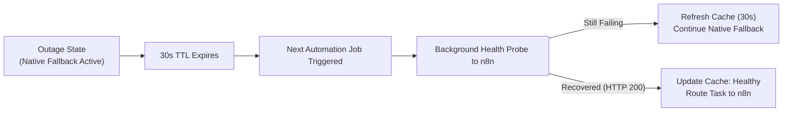

# FloodShield AI Pro — Automatic Failover & Recovery Guide

## 1. Principles of Automatic Failover

In critical disaster response environments, background automation cannot afford downtime. If an external service like n8n becomes unreachable, times out, or experiences configuration drift, mission-critical operations — such as water level monitoring, flood alert generation, hospital inventory checks, and relief requisition escalations — must continue without interruption.

FloodShield AI Pro implements **Autonomous, Zero-Downtime Failover**:
1. **Zero Human Intervention**: Failovers occur instantaneously and automatically inside the task dispatcher without operator commands.
2. **Zero Process Restarts**: The backend application does not crash, reboot, or reload workers during an outage.
3. **Audit Trail Preservation**: Every failover decision records the exact triggering condition (`fallback_reason`) in the database.
4. **Idempotent Dual Protection**: Tasks dispatched to n8n that experience an ambiguous timeout are recorded with status `unknown` and are **not** immediately executed by native automation, preventing duplicated external actions.

---

## 2. Failover Trigger Matrix

| Event / Condition | Detection Point | Automated Failover Action | Logged Detail |
| :--- | :--- | :--- | :--- |
| **Docker Daemon Stopped** | `is_docker_running()` checks named pipe / socket / CLI | Diverts immediately to Native Engine | `"Docker daemon not running on host"` |
| **Network Loss / DNS Failure** | `httpx.ConnectError` during health probe or dispatch | Diverts immediately to Native Engine | `"connection failed: [Errno 11001] getaddrinfo failed"` |
| **HTTP 401 / 403 (Auth Error)** | Webhook returns 401 or 403 | Diverts immediately to Native Engine | `"webhook authentication failed (HTTP 403)"` |
| **HTTP 404 / 410 (Workflow Inactive)** | Webhook returns 404 or 410 | Diverts immediately to Native Engine | `"n8n webhook not found or workflow inactive (HTTP 404)"` |
| **HTTP 422 (Schema Mismatch)** | Webhook returns 422 | Diverts immediately to Native Engine | `"n8n payload rejected with validation error (HTTP 422)"` |
| **HTTP 500 (n8n Server Error)** | Webhook returns 500..599 | Diverts immediately to Native Engine | `"n8n server error (HTTP 500)"` |
| **Request Timeout (>15s)** | `httpx.TimeoutException` | **No Native Execution**. Recorded as `unknown` | `"n8n webhook dispatch timed out after 15s"` |

---

## 3. Autonomous Recovery Mechanism (Self-Healing)

The hybrid controller avoids permanent fallback lock-in by using a periodic health TTL (`N8N_HEALTH_CACHE_SECONDS=30`):



### Key Recovery Features:
- **No Manual Reset**: As soon as n8n recovers and returns HTTP 200, the next scheduled job immediately re-adopts n8n.
- **No Retroactive Collision**: Completed native jobs during the outage remain finished and are never duplicated or re-run on n8n.
- **Safe Reconnection**: Health checks use a non-destructive lightweight ping to verify route stability before dispatching live production tasks.

---

## 4. Edge Cases & Resilience Safeguards

### Edge Case 1: The "Split-Brain" Timeout (Ambiguous Dispatch)
- **Problem**: The backend dispatches an event to n8n. n8n accepts it and begins execution, but network latency or a slow node causes the HTTP connection to time out before n8n can send the `200 OK` response.
- **Risk**: Blindly falling back to Native Automation would cause both n8n and Native to send emergency SMS or update inventory concurrently.
- **Solution**: The engine catches `httpx.TimeoutException`, sets `engine: unknown`, and updates `status: unknown`. It logs the event for administrative reconciliation without running native fallback.

### Edge Case 2: Concurrent Task Race Conditions
- **Problem**: The scheduler triggers a task at the exact millisecond an administrator clicks "Run Now" in the UI.
- **Risk**: Simultaneous duplicate dispatches to n8n or the database.
- **Solution**: Atomic task claiming via `AutomationExecution(task_id=...)` with database unique constraint. The second caller catches `IntegrityError` or finds the existing record and immediately returns `duplicate: True`.

### Edge Case 3: Docker Running But n8n Container Offline
- **Problem**: Docker daemon is active on the host, but the n8n container crashed or was stopped.
- **Solution**: Multi-tier health verification checks both Docker daemon responsiveness AND n8n HTTP endpoint responsiveness.

---

## 5. Step-by-Step Operator Verification Guide

Operators or QA engineers can verify failover behavior using the following steps:

### Test Scenario A: Verify Docker-Stopped Failover
1. Ensure Docker is stopped (or set `MOCK_DOCKER_RUNNING=false` in `.env`).
2. Run an automation task via Admin UI (`/dashboard/admin/jobs`) or API:
   ```bash
   curl -X POST http://localhost:8000/admin/jobs/inventory_monitor/run-now \
        -H "Authorization: Bearer <ADMIN_TOKEN>"
   ```
3. Inspect response: `engine` must be `"native"`, `status` must be `"success"`.
4. Inspect `/admin/automation/status`: `active_engine` displays `"native"`, `docker.running` is `false`.

### Test Scenario B: Verify Webhook Rejection Failover
1. Set an invalid webhook URL in `.env`: `N8N_WEBHOOK_URL=http://localhost:9999/invalid`
2. Trigger any automation task.
3. Observe that the task finishes successfully via Native Automation with `fallback_reason` explaining the connection failure.
4. No exceptions crash the backend process.

### Test Scenario C: Verify Automatic Recovery
1. Restore valid n8n settings in `.env`.
2. Wait 30 seconds for the health cache to expire.
3. Trigger an automation task.
4. Observe that the engine automatically switches back to `"n8n"` without restarting the server.
