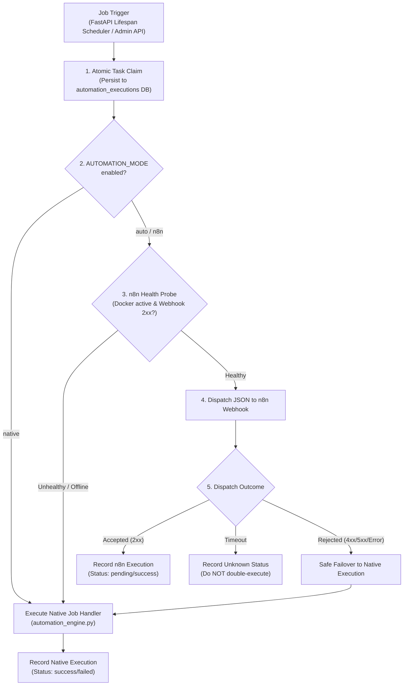
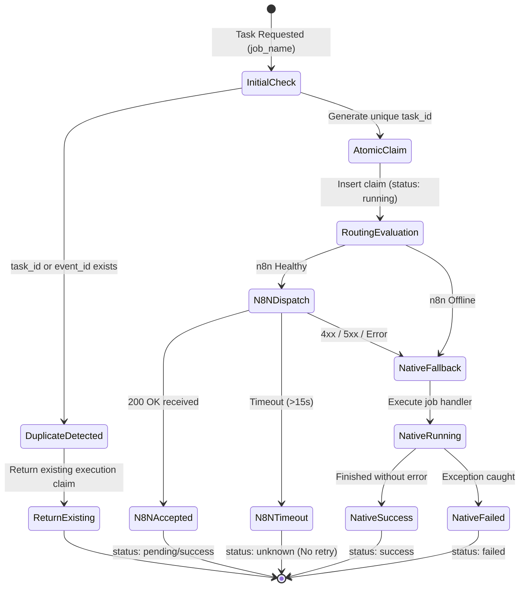

# FloodShield AI Pro — Hybrid Automation Architecture

## 1. Architectural Principles & Overview

The FloodShield AI Pro hybrid automation system operates as a fault-tolerant dual-engine platform. It marries the visual workflow orchestrations of **n8n** with the deterministic, self-contained resilience of the **Native Backend Automation Engine**.

---

## 2. Dynamic Routing Decision Tree (Cases A through G)

The hybrid controller in `backend/app/services/hybrid_automation.py` dynamically evaluates 7 operational scenarios:

| Case | Docker Daemon | n8n Webhook Status | Decision & Execution Path | Failure Handling |
| :--- | :--- | :--- | :--- | :--- |
| **Case A** | Running | Healthy (HTTP 200..299) | **Route to n8n Webhook** | Logged as `engine: n8n`, `status: pending` |
| **Case B** | Stopped | Offline / Unreachable | **Route to Native Automation** | Immediate native execution; no crash |
| **Case C** | Running | Container down / 503 | **Route to Native Automation** | Failover logged with reason |
| **Case D** | Running | Connection refused / DNS error | **Route to Native Automation** | Failover logged with network reason |
| **Case E** | Running | Workflow Inactive / 404 / 422 | **Route to Native Automation** | Failover logged with HTTP status |
| **Case F** | Running | Webhook times out (>15s) | **Mark `status: unknown`, Do NOT run Native** | Prevents dangerous duplicated actions |
| **Case G** | Recovered | Restored to Healthy | **Automatically route future tasks to n8n** | Seamless self-healing without app restart |

---

## 3. Atomic Task Claiming & Idempotency Strategy

To guarantee that duplicate tasks are never executed simultaneously or re-run by racing workers, the system implements atomic claim locking via the `automation_executions` database table:

### Database Schema (`automation_executions`):
- `task_id` (`String(128)`, Primary Key, Indexed): Unique key per execution.
- `event_id` (`String(128)`, Indexed): UUID associated with triggering event.
- `job_name` (`String(64)`): Canonical task name.
- `engine` (`String(32)`): Engine that handled task (`n8n`, `native`, or `unknown`).
- `status` (`String(32)`): Current status (`running`, `pending`, `success`, `failed`, `unknown`).
- `result` (`JSONB / JSON`): Structured result returned by handler or webhook.
- `error` (`Text`): Captured error message or fallback reason.
- `started_at` (`DateTime(timezone=True)`): UTC timestamp when claim was locked.
- `completed_at` (`DateTime(timezone=True)`): UTC timestamp when finished.

---

## 4. Availability & Health Detection Layer

The availability detection in `backend/app/services/n8n_service.py` provides multi-tiered health inspection:

1. **Docker Daemon Inspection (`is_docker_running`)**:
   - Inspects container environment (`/.dockerenv`, `RUNNING_IN_DOCKER`).
   - Probes Docker CLI binary (`docker info --format {{.ServerVersion}}`).
   - Checks platform sockets: Named Pipe (`\\.\pipe\docker_engine`) on Windows, UNIX socket (`/var/run/docker.sock`) on Linux/macOS.
   - Supports `MOCK_DOCKER_RUNNING` environment override for deterministic testing.
   - Result is cached for 30 seconds (`N8N_HEALTH_CACHE_SECONDS`) to prevent CPU overhead.

2. **n8n Webhook Health Probe (`n8n_health_check`)**:
   - Transmits a lightweight probe payload with `test: true`.
   - Distinguishes network connection loss, unauthorized headers, missing routes, and server crashes.
   - Result is cached for 30 seconds to prevent thundering herd requests against the external webhook.

---

## 5. Telemetry & Administration API

The application exposes real-time telemetry through `backend/app/routers/automation_admin.py`:

- **Endpoint**: `GET /admin/automation/status`
- **Output Structure**:
  - `active_engine`: Primary active engine (`"n8n"` if healthy, `"native"` otherwise).
  - `native_status`: Always `"available"`.
  - `docker`: `{ "running": bool, "status": str }`
  - `n8n`: `{ "enabled": bool, "healthy": bool, "reason": str, "status_code": int, "last_health_check": str }`
  - `counts`: Aggregated total, n8n, native, success, failed, unknown, pending runs.
  - `recent_executions`: Last 20 execution records.
  - `recent_errors`: Last 5 error traces.
  - `last_successful_execution`: Timestamp of most recent successful task.
